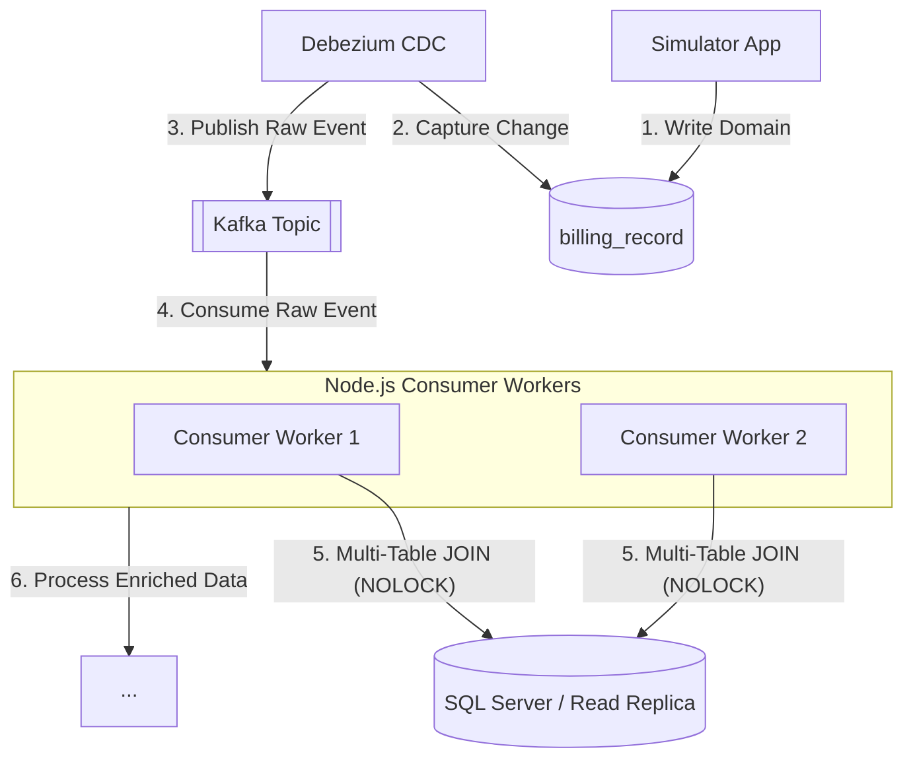

# Approach 5: CDC Push + Consumer Enrichment

**Description:**
Debezium captures and pushes raw changes immediately. Downstream consumer workers consume the raw events from Kafka and enrich them by performing direct, non-blocking multi-table JOINs (often against a read replica or using NOLOCK hints) before passing the fully enriched event to its final destination.

### Pros:
- **High Ingestion Throughput**: The CDC pipeline remains incredibly fast and unblocked, as no transformations or synchronous actions occur in Kafka Connect.
- **Horizontal Scalability**: Consumer workers can be easily scaled out to handle heavy processing/enrichment loads concurrently.

### Cons:
- **Increased Database Load**: Shifting enrichment queries to the consumer side can cause heavy read traffic on the database (mitigated by using Read Replicas).
- **Idempotency Requirements**: Because consumers handle enrichment and final delivery, they must carefully handle duplicate events and implement strong idempotency.

### In the simulator
- Each subscriber is its own Kafka consumer group (so every subscriber processes every event), hosted on up
  to 4 worker threads. Consumer groups are fresh per run and start at the run's first offset.
- The enrichment JOIN is keyed by the event's billing id and batch id (`before` image for deletes):
  `invoice_batch → subscriber_plan`, `billing_record` by id, `subscriber_usage` by batch, `rate_schedule` by plan
  and usage type. Tombstones are skipped.
- Reported: enrichment latency, commit → enriched latency (from `source.ts_ms`), consumer lag per run, failures
  and lookups that returned no reference data.
